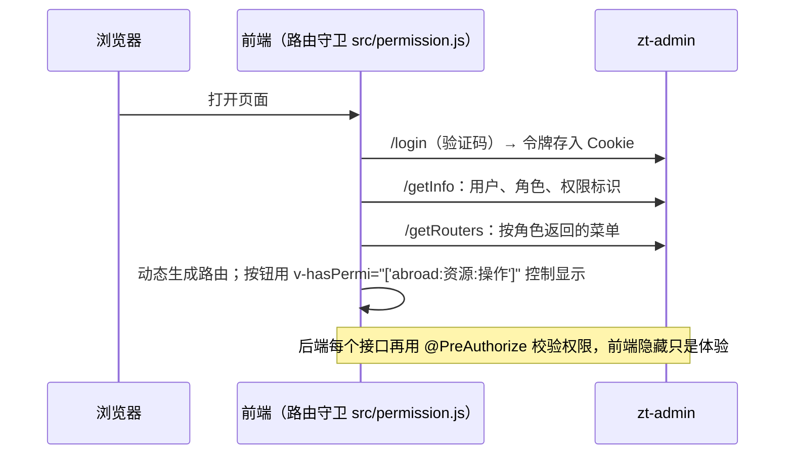

# zt-abroad-vue · 留学智能体平台管理后台（前端）

工作室负责人、顾问、数据录入人员使用的管理后台：RuoYi 系统管理 + “留学业务”菜单（院校库、测评与选校引擎参数、线索看板、AI 审核等，按开发计划逐步加入）。

- **后端**：同级工程 `../zt-abroad-parent` 的 `zt-admin`（8090），业务接口统一在 `/abroad/*`，其余为 RuoYi 原有路径。
- **技术栈**：Vue 3.5 + Vite 6 + Element Plus 2 + Pinia；基于 RuoYi-Vue3 3.9.2，脚手架与 `zt-vue` 相同。
- **规范**：[doc/前端开发规范.md](doc/前端开发规范.md)（强制）；页面清单与验收标准见后端工程 `doc/研发/04-模块拆分.md`。
- 学生端（微信小程序 + H5）为独立 uni-app 工程，不在本仓库。

## 登录与菜单



## 本地运行

```bash
npm install                    # 或 yarn
npm run dev                    # http://localhost:80，/dev-api 代理到 http://localhost:8090（去掉前缀）
ZT_BACKEND=http://host:8090 npm run dev   # 后端在其他地址时
```

后端先按 `../zt-abroad-parent/README.md` 启动（`docker compose up -d --build`）。默认账号 admin/admin123 **仅限本地**，生产首次登录后立即修改。

## 构建与部署

```bash
npm run build:stage            # 测试环境（.env.staging）
npm run build:prod             # 生产环境（.env.production，接口前缀 /prod-api，gzip）
```

产物在 `dist/`，由 Nginx 提供静态资源，并把 `/prod-api/` 反向代理到 zt-admin（去掉前缀）。

## 目录

| 目录 | 内容 |
| --- | --- |
| `src/api/` | 接口（RuoYi 系统接口；留学业务放 `abroad/`，一个资源一个文件） |
| `src/views/` | 页面（RuoYi 系统页面；留学业务放 `abroad/<资源>/index.vue`） |
| `src/components/`、`src/layout/`、`src/store/`、`src/router/` | RuoYi 框架：通用组件、布局、状态、路由（菜单由后端返回） |
| `doc/前端开发规范.md` | 前端开发规范 |

## 致谢

基于 [RuoYi-Vue3](https://gitee.com/y_project/RuoYi-Vue3) 二次开发（MIT 许可）。
